# 💳 LBin Gen

**Gerador de dados de teste para cartões — bonito, rápido e sem dependências.**

Kit de linha de comando e interface interativa para gerar números de cartão válidos por Luhn,
consultar BINs públicos, montar combinações de validade/CVV, validar lotes e exportar em 8 formatos.
Feito para laboratório, sandbox de pagamento, QA e estudos de segurança — roda em **Windows, Linux e Termux/Android**.

[](https://github.com/lalaio1/LBin-gen/actions/workflows/ci.yml)
[](https://www.python.org/)
[](requirements.txt)
[](#-instalação)
[](CHANGELOG.md)
[](LICENSE)
[](https://t.me/lalaio1)

> **Aviso**: esta ferramenta gera **dados fictícios de teste** (números que passam no algoritmo de Luhn).
> Use somente em **ambientes que você controla**, testes autorizados e sandbox. Não há vínculo com contas reais,
> e qualquer uso contra terceiros é proibido pela licença e pela lei.

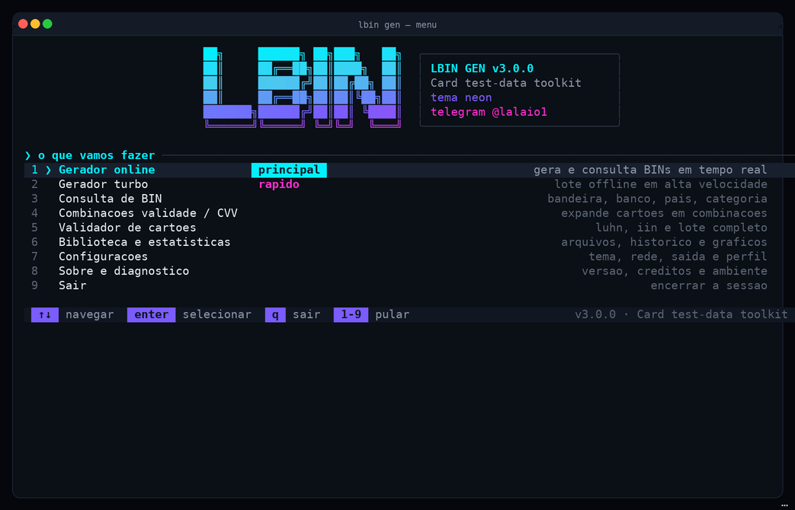

---

## ✨ Recursos

| | |
|---|---|
| 🎲 **Geração Luhn-válida** | BIN, comprimento, bandeira, validade e CVV configuráveis |
| ⚡ **Gerador turbo** | ~60.000 cartões/s offline, com escrita incremental no disco |
| 🔎 **Consulta de BIN** | Base offline embutida + provedores públicos (`binlist.net`), cache e proxy |
| 🧬 **Combinações** | Expande um cartão em meses × anos × CVV (faixa completa ou amostra) |
| ✅ **Validador** | Luhn, IIN/bandeira e comprimento — individual ou lote de arquivo |
| 🧾 **8 formatos** | `txt`, `csv`, `json`, `jsonl`, `js`, `sql`, `xml`, `html` (JSON/HTML válidos de verdade) |
| 🎨 **UI própria** | truecolor → 256 → 16 → sem cor, glifos unicode/ascii, 6 temas, telas adaptáveis |
| 📊 **Biblioteca** | Histórico local, gráficos de bandeiras, atividade de 14 dias e preview de arquivos |
| 📦 **Zero dependências** | Somente biblioteca padrão do Python — instala em qualquer lugar |
| 🐧 **Multiplataforma** | Windows (CMD/PowerShell/Windows Terminal), Linux e Termux (Android) |

---

## 🖼️ Telas

Todas as imagens abaixo são capturas reais do programa (modo demonstração, tema `neon`).

### Gerador online — gera e consulta BINs em tempo real

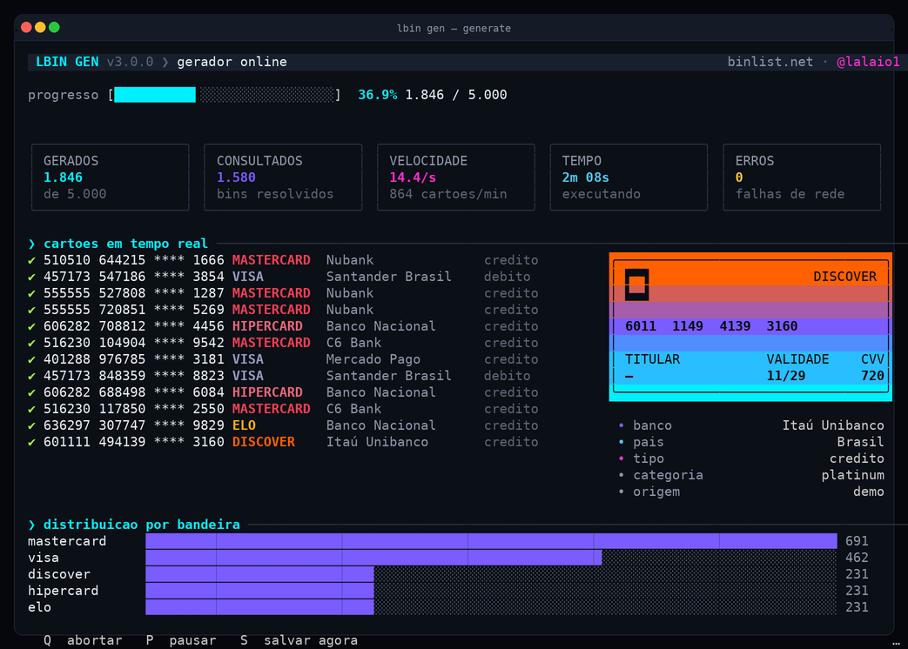

### Gerador turbo — lote offline em alta velocidade

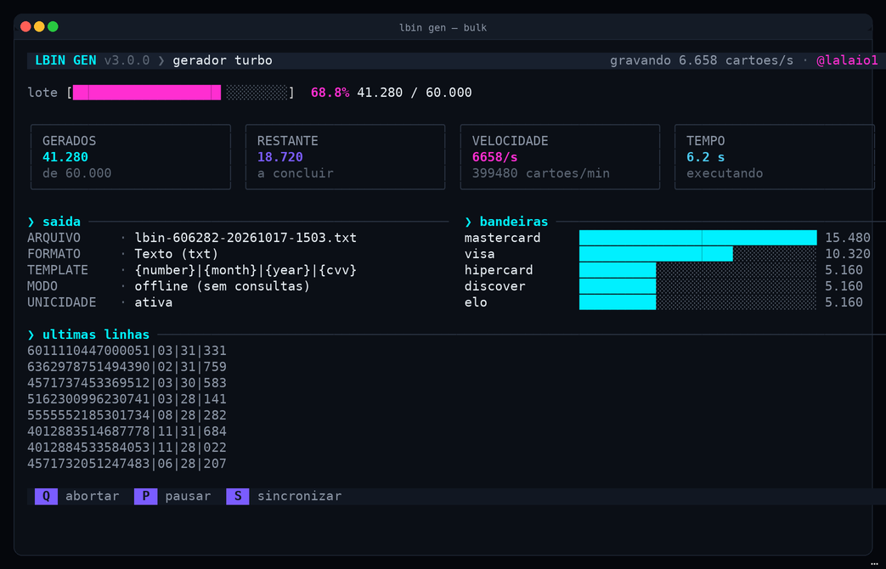

<details>
<summary><strong>Ver todas as telas (clique para expandir)</strong></summary>

#### Consulta de BIN
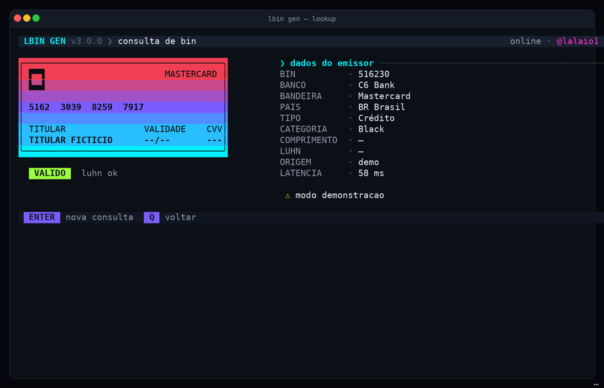

#### Combinações de validade / CVV
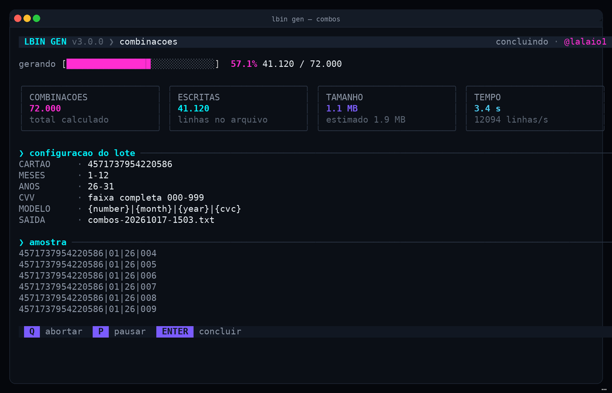

#### Validador
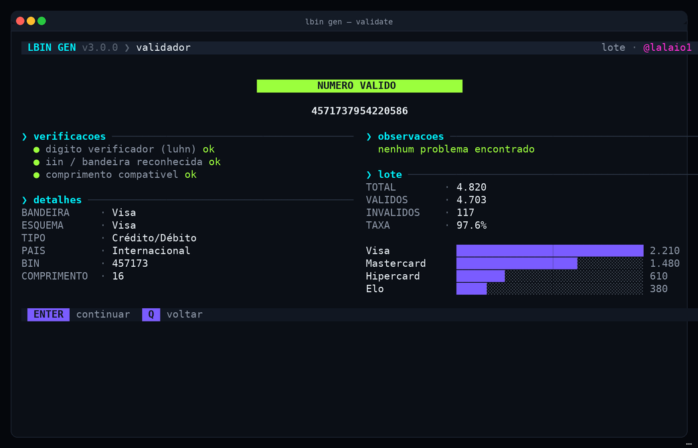

#### Biblioteca e estatísticas
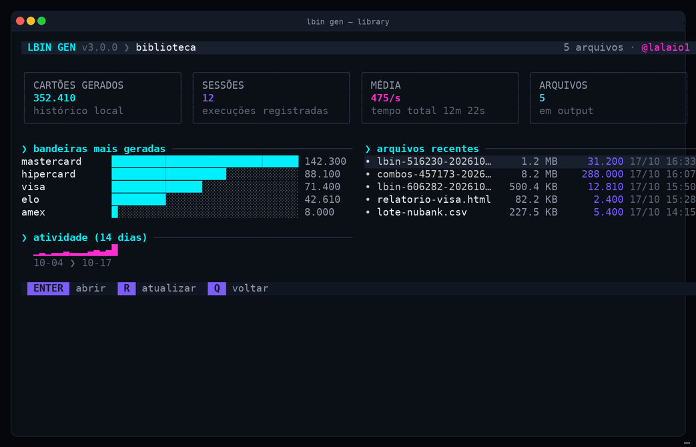

#### Configurações
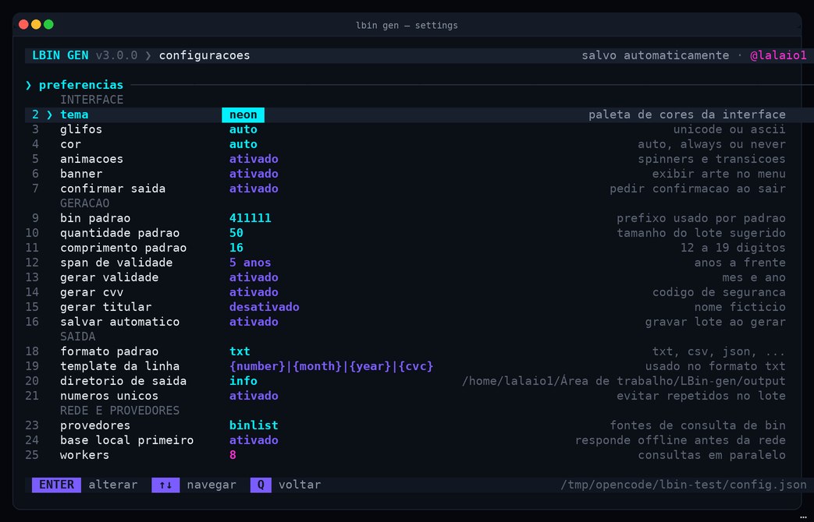

#### Sobre / créditos
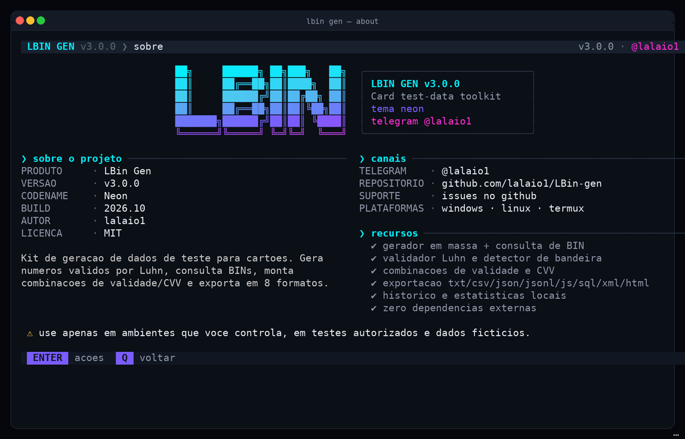

#### Diagnóstico do ambiente
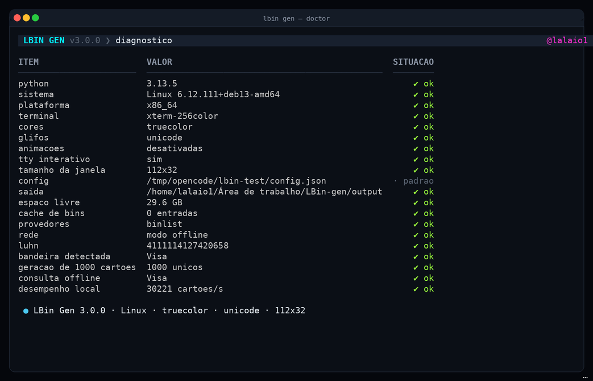

#### Primeiro uso — aviso de responsabilidade
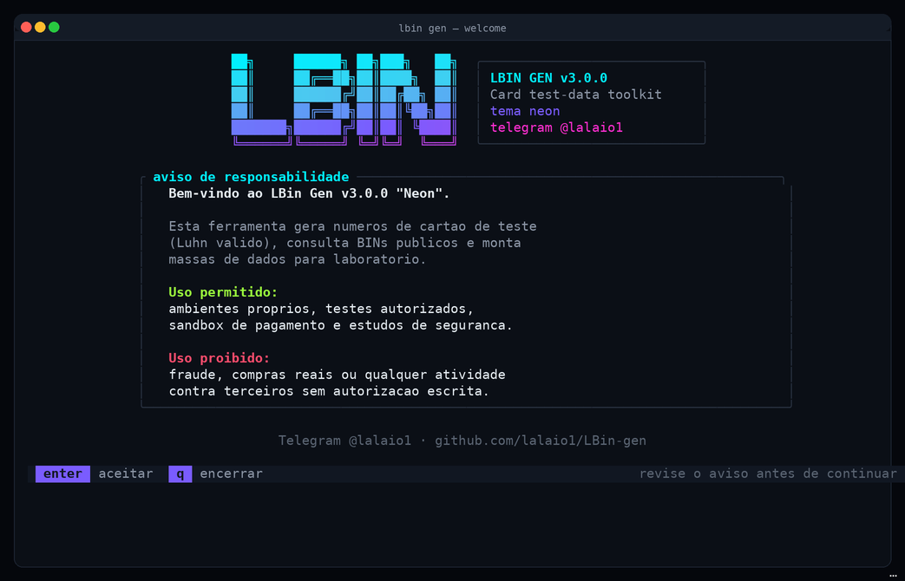

#### Termux / terminal estreito (56×24)
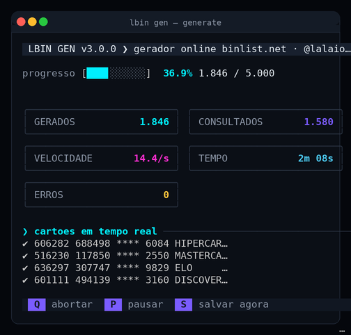

</details>

---

## 📦 Instalação

Requisito único: **Python 3.9 ou superior**. Nenhum `pip install` necessário.

### 🐧 Linux

```bash
sudo apt install python3        # se ainda não tiver
git clone https://github.com/lalaio1/LBin-gen.git
cd LBin-gen
python3 start.py
```

### 🪟 Windows

1. Instale o Python em [python.org/downloads](https://www.python.org/downloads/) — marque **“Add Python to PATH”**.
2. Baixe o repositório (`git clone https://github.com/lalaio1/LBin-gen.git` ou “Code → Download ZIP”).
3. Abra a pasta e execute:

```powershell
python start.py
```

> Dica: no Windows Terminal o visual fica completo (truecolor + unicode). No `cmd.exe` clássico a ferramenta
> detecta a limitação e cai para modo compatível automaticamente.

### 📱 Termux / Android

```bash
pkg update && pkg install python git
git clone https://github.com/lalaio1/LBin-gen.git
cd LBin-gen
python start.py
```

> A interface é adaptável: em telas estreitas (ex.: 56 colunas) os painéis compactam sem quebrar o layout.

### 🔧 Opcional — comando global `lbin`

```bash
pip install -e .        # instala o console script "lbin"
lbin gen -b 411111 -n 10
```

---

## 🚀 Uso rápido

```bash
python3 start.py                       # abre o menu interativo (padrão)

# 20 cartões Visa com BIN fixo, saída em CSV
python3 start.py gen -b 411111 -n 20 --format csv --out lote.csv

# 50.000 cartões Hipercard offline em alta velocidade
python3 start.py bulk -b 606282 -n 50000 -o lote.txt

# Consultar BINs (offline primeiro; use --online para provedores)
python3 start.py lookup 516230 457173

# Validar um número ou um arquivo inteiro
python3 start.py validate 4111111111111111
python3 start.py validate --file lote.txt --json

# Todas as combinações de validade e CVV de um cartão
python3 start.py combos 4111111111111111 --years 26-31 --cvv-mode range --out combos.txt

# Converter um arquivo já existente
python3 start.py export lote.txt --format html
```

### Comandos disponíveis

| Comando | O que faz |
|---|---|
| `menu` | Interface interativa completa (padrão) |
| `gen` | Gera cartões, opcionalmente consultando BINs online (`--online`) |
| `bulk` | Geração offline em massa (máxima velocidade, escrita incremental) |
| `lookup` | Consulta um ou vários BINs |
| `validate` | Valida número individual ou lote (`--file`, `--json`) |
| `combos` | Expande cartão em combinações de meses × anos × CVV |
| `library` | Lista e resume os arquivos gerados |
| `export` | Converte arquivos entre os 8 formatos |
| `doctor` | Diagnóstico do ambiente (terminal, rede, caminhos) |
| `about` | Créditos, versão e canais |
| `demo` | Renderiza qualquer tela com dados fictícios (útil para screenshots) |

Flags globais: `--color {auto,always,never}`, `--ascii`, `--no-anim`, `--width N`, `--yes`, `--version`.

### Formatos de exportação

`txt` · `csv` · `json` · `jsonl` · `js` · `sql` · `xml` · `html`

O template padrão é `{number}|{month}|{year}|{cvc}` e pode ser trocado, por exemplo:
`--template "{number},{month}/{year},{cvc}"`. Campos extras disponíveis: `{brand}`, `{bank}`, `{country}`,
`{holder}`, `{year_full}`, `{source}`.

---

## ⌨️ Atalhos da interface

| Tecla | Ação |
|---|---|
| `↑` `↓` / `k` `j` | Navegar no menu |
| `enter` | Selecionar |
| `1`–`9` | Pular direto para o item |
| `q` / `esc` | Voltar / sair |
| `p` | Pausar a geração |
| `s` | Salvar/flush imediato do arquivo |

Sem TTY (pipe, CI, cron) a interface degrada para listas numeradas — nada trava.

---

## 📁 Onde ficam os arquivos

| Item | Linux | Windows |
|---|---|---|
| Configuração | `~/.config/lbin/config.json` | `%APPDATA%\LBin\config.json` |
| Histórico | `~/.config/lbin/history.json` | `%APPDATA%\LBin\history.json` |
| Cache de BINs | `~/.config/lbin/cache/bin-cache.json` | `%APPDATA%\LBin\cache\bin-cache.json` |
| Saídas | pasta informada em `--out`/`-o` (senão `./output/`) | idem |

Defina `LBIN_HOME=/algum/dir` para isolar tudo em testes.

---

## 🧩 Estrutura do projeto

```
LBin-gen/
├── start.py               # launcher multiplataforma (python start.py)
├── lbin/
│   ├── app/               # cli, menu, telas, jobs ao vivo, views e demo
│   ├── core/              # luhn, generator, brands, binlookup, combos,
│   │                      # validator, exporters, storage
│   └── ui/                # motor ANSI (cores, glifos, temas, widgets, tela)
├── tests/                 # suíte unittest (luhn, generator, exporters, views, ...)
├── docs/images/           # screenshots usados neste README
└── pyproject.toml         # metadados + console script opcional
```

---

## 🔐 Privacidade e escopo

- Tudo roda **localmente**. Nenhum dado é enviado a servidores do projeto.
- A consulta de BIN é **opcional** e, quando ativada, envia apenas o prefixo de 6–8 dígitos ao provedor público escolhido.
- Os números gerados são **fictícios**: combinam prefixo real de bandeira com dígito verificador calculado.
  Eles **não pertencem a cartões reais** e não funcionam em transações.
- Cache e histórico ficam apenas na sua máquina e podem ser apagados pelas Configurações.

## ⚖️ Aviso legal

Esta ferramenta existe para **teste de software, pesquisa e educação** em ambientes autorizados
(sandbox de gateway de pagamento, QA de validação de formulário, treinamento de detecção de fraude etc.).

É proibido usá-la para fraude, compras reais, engenharia social ou qualquer atividade contra terceiros
sem autorização escrita. O autor não se responsabiliza por uso indevido — veja a [licença](LICENSE).

## ❓ Problemas comuns

| Sintoma | Solução |
|---|---|
| Cores “estranhas” ou caracteres tortos | Use Windows Terminal, ou rode com `--ascii` / `--color=16` |
| `python: command not found` | No Linux use `python3`; no Windows marque “Add Python to PATH” |
| Consulta online não retorna nada | `lookup.binlist.net` pode estar bloqueado; a ferramenta já cai para a base offline |
| Quero tudo limpo para recomeçar | `LBIN_HOME=/tmp/lbin-fresh python3 start.py` ou remova a pasta de config |

## 🤝 Contribuindo

1. Faça um fork e crie um branch (`git checkout -b feat/minha-ideia`).
2. Rode os testes: `python3 -m unittest discover -s tests`.
3. Mantenha o estilo: português nas mensagens, zero dependências novas, comentários só quando indispensáveis.
4. Abra um Pull Request descrevendo o antes/depois (screenshots ajudam!).

## 📬 Contato

- Telegram: [@lalaio1](https://t.me/lalaio1)
- Issues: [github.com/lalaio1/LBin-gen/issues](https://github.com/lalaio1/LBin-gen/issues)

## 📄 Licença

Apache License 2.0 — veja [LICENSE](LICENSE).
